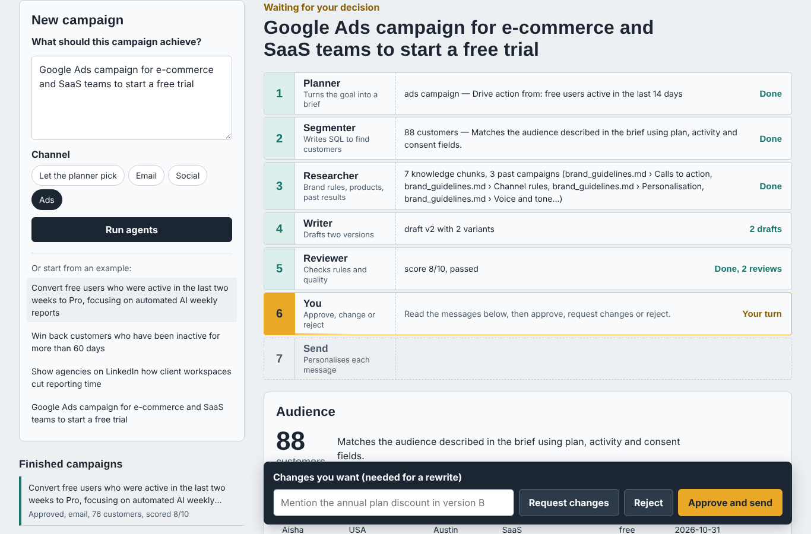
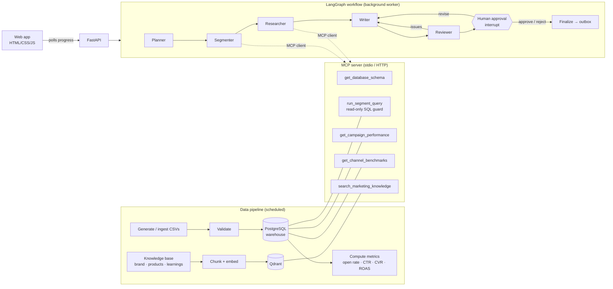

# 📣 CampaignPilot

**A multi-agent marketing campaign assistant built with LangGraph, RAG (Qdrant), and a custom MCP server.**

You describe a campaign goal in plain English — *"Convert free users who were active in the last two weeks to Pro"* — and a team of AI agents plans it, finds the right audience in the customer database, researches brand rules and past results, writes A/B variants, reviews them against brand guidelines, and then **pauses for a human to approve** before anything is sent.

[](https://github.com/adeebmansoor/campaignpilot/actions/workflows/ci.yml)



---

## What it does

| Agent | Job | How |
|---|---|---|
| **Planner** | Turns the goal into a structured brief (channel, audience, key message, KPI) | Gemini with structured JSON output |
| **Segmenter** | Writes SQL to find the target customers, runs it, **fixes its own errors** | MCP tools → read-only SQL over the warehouse |
| **Researcher** | Pulls brand rules, product facts and past campaign learnings, plus channel benchmarks | RAG over Qdrant + campaign metrics, via MCP |
| **Writer** | Writes two A/B variants with `{{first_name}}` personalisation | Gemini, grounded in retrieved context |
| **Reviewer** | Scores the draft and lists issues; sends it back for a rewrite if needed | Code-based brand guardrails **+** LLM review |
| **Human** | Approves, rejects, or requests changes with feedback | LangGraph `interrupt()` + persisted checkpoints |
| **Finalize** | Renders personalised messages and writes them to the outbox (simulated send) | — |

The web app shows each agent's progress live as a rack of "flight strips", previews every message the way it would look in an inbox, a search ad or a social feed, and keeps a sticky approval bar until you decide.

Everything runs on a realistic synthetic dataset for a fictional SaaS company, **Brightloop**: 2,000 customers, 12 past campaigns across email, social and ads, and ~10,000 funnel events (sent → open → click → convert).

## Architecture



More detail in [`docs/architecture.md`](docs/architecture.md).

## Tech stack

- **Agents:** LangGraph (state graph, conditional edges, human-in-the-loop `interrupt`, SQLite checkpointer), runs executed in a background worker and polled for live progress
- **LLM:** Google Gemini (`gemini-2.5-flash`) via `langchain-google-genai`, structured outputs with Pydantic
- **RAG:** Qdrant vector database + Gemini embeddings
- **MCP:** Official MCP Python SDK (2.x) — custom server with 5 tools and 1 resource; agents use it as a client over stdio
- **Data:** PostgreSQL (SQLite in single-container mode), SQLAlchemy 2, pandas ETL
- **Web:** FastAPI + a dependency-free HTML/CSS/JavaScript front end (no build step)
- **Ops:** Docker, Docker Compose, GitHub Actions (lint, 43 tests, Postgres job, container smoke test, auto-deploy to Hugging Face Spaces)

---

## Run it

### On your computer (one click)

You need [Docker Desktop](https://www.docker.com/products/docker-desktop) running and a free [Gemini API key](https://aistudio.google.com/apikey).

```bash
git clone https://github.com/adeebmansoor/campaignpilot.git
```

- **Windows:** open the `campaignpilot` folder and double-click **`start.bat`**. To stop, double-click **`stop.bat`**.
- **Mac/Linux:** `cd campaignpilot && ./start.sh`. To stop, `./stop.sh`.

The first start creates `.env` and opens it so you can paste your Gemini key after `GOOGLE_API_KEY=`. Run the start script again and the app opens at **http://localhost:8000** (API docs at `/docs`, Qdrant dashboard at http://localhost:6333/dashboard). Data is kept between restarts.

### Free online deployment (Hugging Face Spaces)

The repo deploys itself to a free [Hugging Face Space](https://huggingface.co/docs/hub/spaces-sdks-docker) after every successful CI run on `main`. One-time setup:

1. Create a free account at https://huggingface.co.
2. Create an access token at https://huggingface.co/settings/tokens with **Write** permission.
3. In this GitHub repo, go to **Settings → Secrets and variables → Actions → New repository secret** and add:
   - `HF_TOKEN`: the Hugging Face token
   - `GOOGLE_API_KEY`: your Gemini key (stored as a secret on the Space, never in code)
   - `DEMO_ACCESS_CODE` *(optional)*: a code visitors must type before running agents, to protect your free Gemini quota
4. Go to the **Actions** tab, open **Deploy to Hugging Face Spaces**, and click **Run workflow** (later pushes deploy automatically).

The app appears at `https://<your-hf-username>-campaignpilot.hf.space` after the build (about 5 minutes). On the free tier the Space sleeps after a period without visitors and wakes up on the next visit; its data is regenerated on each start. Public runs are also capped by `MAX_RUNS_PER_HOUR` (20 on the Space).

### Local Python (no Docker)

```bash
python -m venv .venv && source .venv/bin/activate     # Windows: .venv\Scripts\activate
pip install -r requirements-dev.txt
cp .env.example .env                                   # add GOOGLE_API_KEY
sh scripts/start-app.sh                                # loads data, then serves http://localhost:8000
```

Local mode uses SQLite and an on-disk Qdrant folder, so no other services are needed.

### No API key? Use demo mode

Set `LLM_PROVIDER=fake` in `.env` (add `FAKE_LLM_DELAY=1` to watch the strips move). The whole workflow runs with deterministic offline responses; this is also what CI uses. The fake writer's first draft deliberately breaks a brand rule, so you can watch the reviewer send it back.

---

## Using it

**Terminal:**

```bash
python -m campaignpilot.cli "Win back customers inactive for more than 60 days with an email"
python -m campaignpilot.cli "Promote agency client workspaces" --channel social
```

You'll see the agent trace, the SQL segment, the review and both variants, then a prompt to approve, revise or reject.

**API:**

```bash
# start a run — ?wait=true returns when it pauses for approval
# (without it the call returns at once and you poll GET /campaigns/<thread_id>)
curl -X POST "localhost:8000/campaigns?wait=true" -H 'Content-Type: application/json' \
  -d '{"goal": "Convert active free users to Pro with an email about AI weekly reports"}'

# request changes
curl -X POST "localhost:8000/campaigns/<thread_id>/decision?wait=true" -H 'Content-Type: application/json' \
  -d '{"decision": "revise", "feedback": "Mention the annual plan discount in variant B"}'

# approve
curl -X POST "localhost:8000/campaigns/<thread_id>/decision?wait=true" -H 'Content-Type: application/json' \
  -d '{"decision": "approve"}'
```

**Use the MCP server from Claude Desktop (or any MCP client):** add this to your client's MCP config, then ask it things like *"How many UAE customers on the Pro plan opted in to email?"*

```json
{
  "mcpServers": {
    "campaignpilot": {
      "command": "/path/to/campaignpilot/.venv/bin/python",
      "args": ["-m", "campaignpilot.mcp_server.server"],
      "cwd": "/path/to/campaignpilot"
    }
  }
}
```

Or serve it over HTTP for remote clients: `python -m campaignpilot.mcp_server.server --http --port 8765`.

---

## Engineering decisions

These are the parts worth talking about in an interview:

1. **Agents never touch the database directly.** They only get MCP tools. `run_segment_query` accepts a single `SELECT`, blocks write keywords, comments and multiple statements, allows only known tables, runs inside a transaction that is always rolled back, and uses `SET TRANSACTION READ ONLY` on Postgres.
2. **Self-correcting SQL.** If the generated SQL fails, returns zero rows, or (for email) is missing the `email_opt_in = 1` consent filter, the error is fed back to the LLM for up to three attempts. Tool errors are passed through MCP as readable `ToolError`s so the model can fix them, while unexpected exceptions stay generic so internals aren't leaked.
3. **Guardrails in code, judgement in the LLM.** Banned words, length limits, unsubscribe lines, allowed CTAs and personalisation tokens are checked deterministically (`agents/guardrails.py`). The LLM reviewer only scores quality and fit. A draft passes only if both agree.
4. **Human-in-the-loop by design.** The graph pauses with `interrupt()`. State is saved by a SQLite checkpointer, so a run waiting for approval survives an API restart. Any unclear decision fails safe to *reject*.
5. **Structured outputs everywhere.** Every agent returns a Pydantic model, so the next agent receives validated data instead of free text.
6. **One tool layer, two transports.** The same tool functions are exposed via MCP (`TOOLS_MODE=mcp`) or called in-process (`TOOLS_MODE=direct`). The agents don't know the difference.
7. **Idempotent pipeline.** Each ETL run validates rows (bad plans, unknown foreign keys, duplicates are rejected and counted) and replaces the warehouse in one transaction, so re-runs never duplicate data and a failed run leaves the old data intact.
8. **Live progress without websockets.** Runs execute in a background worker; the checkpointer saves state after every agent, and the browser polls it. Simple, robust behind any proxy, and the same mechanism that makes runs resumable.
9. **Safe to put online.** An optional access code (constant-time compare) and a global hourly run cap protect the free LLM quota on the public demo. All model output is rendered with `textContent`, never `innerHTML`, so generated copy can't inject markup.
10. **Testable without an API key.** A fake LLM client and hash embeddings make the full workflow deterministic. The test suite starts the real MCP server over stdio, and a separate CI job runs the pipeline and agents on PostgreSQL.

## Project structure

```
campaignpilot/
├── agents/
│   ├── graph.py          # LangGraph workflow: nodes, edges, interrupt
│   ├── schemas.py        # Pydantic outputs for each agent
│   ├── prompts.py        # system prompts
│   ├── guardrails.py     # deterministic brand/compliance checks
│   └── service.py        # start / resume / inspect runs (checkpointer)
├── mcp_server/server.py  # MCP server: tools + resource
├── tools/
│   ├── marketing_tools.py  # the tool functions + read-only SQL guard
│   └── client.py           # MCP client (stdio) and direct client
├── rag/store.py          # chunking, embeddings, Qdrant index + search
├── pipeline/             # synthetic data generator, ETL, metrics, scheduler
├── db/                   # SQLAlchemy models and session
├── api/main.py           # FastAPI: REST API, access code, rate limit, serves the web app
├── web/                  # front end: index.html, styles.css, app.js
├── llm.py                # Gemini client + fake client for tests
└── cli.py                # terminal interface
data/knowledge/           # brand guidelines, products, past learnings (RAG source)
scripts/                  # start-app.sh (single container), deploy_space.py (Hugging Face)
start.bat / start.sh      # one-click local start (stop.bat / stop.sh to stop)
tests/                    # 43 tests: pipeline, SQL guard, guardrails, RAG, MCP, graph, API
```

## Tests

```bash
pytest -v          # runs fully offline
ruff check .
```

## How to learn from this codebase

Read the code in the same order the data flows, and run each piece as you go:

1. `pipeline/generate_data.py` → `pipeline/etl.py` — run `python -m campaignpilot.pipeline.run`, then open `data/campaignpilot.db` in a SQLite viewer and query `campaign_metrics`.
2. `rag/store.py` — call `search("banned words")` in a Python shell and look at the scores.
3. `tools/marketing_tools.py` → `mcp_server/server.py` → `tools/client.py` — run `tests/test_mcp.py` and try breaking the SQL guard.
4. `agents/schemas.py` → `agents/graph.py` — follow one run through `python -m campaignpilot.cli "..."` with `LLM_PROVIDER=fake`, then switch to Gemini and compare.
5. `agents/service.py` (background runs) → `api/main.py` → `web/app.js` (polling and rendering).

## Roadmap

- [ ] Route all LLM calls through an LLM gateway (fallback, caching, cost tracking)
- [ ] Real send integrations (SendGrid / Mailchimp for email, Meta and Google Ads APIs)
- [ ] Prompt evaluation set: score segment SQL and copy quality across ~30 goals when prompts change
- [ ] A/B test results feeding back into the knowledge base automatically
- [ ] Deploy to AWS (ECS + RDS + managed Qdrant) with Terraform

## Notes

The dataset and company (Brightloop) are synthetic, generated by `pipeline/generate_data.py`, so no real customer data is used. Swap in a CRM export or a Kaggle marketing dataset by producing CSVs with the same columns.

---

Built by [Adeeb Mansoor](https://www.linkedin.com/in/adeeb-mansoor-96634a289/) · [Portfolio](https://portfolio-adeeb.netlify.app/)
